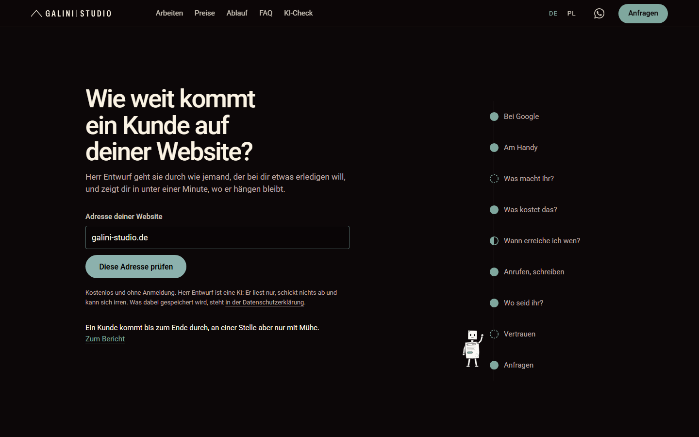
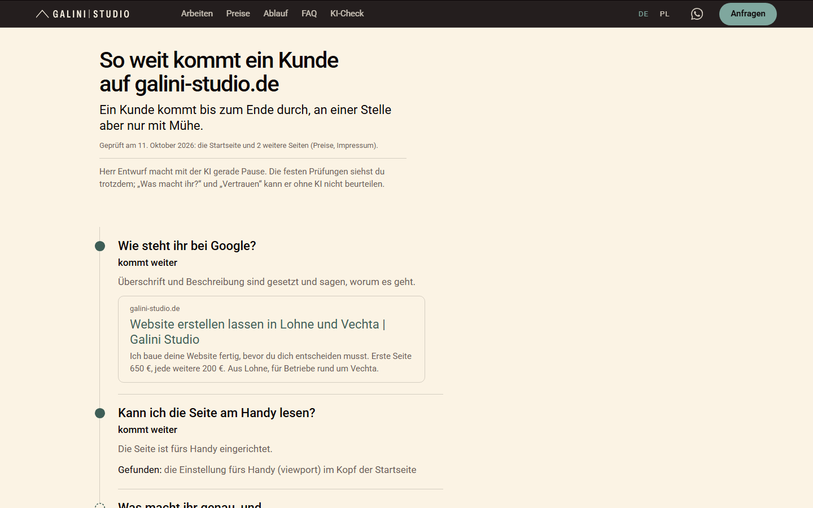

# AI Website Check

**An AI that walks through a small-business website like a customer, and has to prove every claim with a quote.**

Live demo: <https://galini-studio.de/ki-check/> (German) · <https://galini-studio.de/pl/sprawdz-strone/> (Polish)



A customer who wants something done (book a car service, get a roof fixed) goes through a website in a typical order. Can I find you on Google? Can I read the page on my phone? What do you do, and what does it cost? When can I reach someone, and can I tap the number? Where are you? Can I trust you? Can I send an inquiry?

AI Website Check (on the site: "KI-Check", KI is German for AI) goes through these nine stations and shows where a customer **gets stuck**. It runs in under a minute and gives a report as a page and as a PDF. It was built for small businesses in Germany, in German and Polish, as a free tool on the website of a small web studio.

## The rule that matters: no quote, no claim

Language models are good at reading a messy small-business site and noticing what a person would notice. They are also good at sounding sure about things that are not there. So the check splits the work:

1. **Collect, without AI** (`src/sammeln.ts`). It reads the start page and up to six sub-pages (contact, prices, booking, hours, services, legal notice) the way many AI assistants see them: the HTML, without JavaScript. It extracts hard facts: tappable `tel:` links, WhatsApp, forms (with field counts), booking services, opening hours, prices, address, schema.org data, `robots.txt`, broken links and leftover template text.
2. **Read like a customer, with AI** (`src/kunde.ts`). Claude gets the collected text and answers seven customer questions with structured output. **Each answer must quote the site verbatim.** The server checks every quote against the material (`zitatBelegt`). An answer without a verified quote does not count.
3. **Decide** (`src/bewerten.ts`). Rules first, then the verified AI answers. Where the HTML is certain (a form, a booking link, a tappable number), the rule has the last word. "I did not find it", never "it is missing": the check only reads the HTML and can overlook things.

The result (`src/bericht.ts`) holds only what the report shows: no raw signals, no prompt material.

## Does it work?

Tested on 13 sites before launch, every result checked by hand ([docs/EVALUATION.md](docs/EVALUATION.md)):

- The rules alone were right in **62 of 65** cases. The three misses were fixed or left to the AI.
- Two rounds with the AI on all sites: **no invented quote got through**. The one quote that was not verbatim was rejected by the server.
- About 7,700 tokens in and 1,200 out per site, a few cents per check.

## Careful by design

- **Reads, never submits.** No forms, no bookings, no inquiries.
- **Follows `robots.txt`** (RFC 9309, with `*` and `$`). Pages blocked for the check or for all bots are not read; if the start page is blocked, there is no report. If the file blocks AI assistants that read on a user's behalf (ChatGPT-User, Claude-User, Perplexity), the report is made without AI. Only explicit rules count: no `robots.txt` means the check reads like a browser.
- **Only public servers** (no private or local addresses, checked after every redirect), at most 4 redirects, 8 seconds and 3 MB per page, a fixed time budget for the whole check.
- **Honest about gaps.** If a page does not load, the report says so instead of claiming something is missing. Connection problems that could be on our side are never reported as the site's fault.

## Try it

Needs Node.js 22 or newer.

```bash
npm install
npx tsx src/cli.ts example.com              # report in German
npx tsx src/cli.ts example.com --pl         # report in Polish
npx tsx src/cli.ts example.com --json r.json
npm test                                    # pattern and robots.txt tests, no network
```

Without `ANTHROPIC_API_KEY` the check runs with the fixed rules only (free). With a key it adds the AI part (a few cents per check). Please set `KI_CHECK_KENNUNG` to a user agent with your contact (see `.env.example`), so site owners know who is reading. Only check sites you own or have a good reason to check.

An example run (rules only) on the author's own site: [docs/beispiel-galini-studio.txt](docs/beispiel-galini-studio.txt).



## Files

| File | What it does |
|---|---|
| `src/sammeln.ts` | Collect: fetch, safety checks, robots.txt, extract signals and quotes |
| `src/kunde.ts` | The AI as a customer: prompt, structured output, quote check |
| `src/bewerten.ts` | Traffic light per question, report sentences in German and Polish |
| `src/bericht.ts` | What the report contains |
| `src/cli.ts` | Command line |
| `test/` | Tests for the patterns, the quote check and robots.txt |
| `docs/EVALUATION.md` | How it was tested |

The code and its comments are in German, like the reports. The comments keep notes from testing ("Testlauf 09.10.2026: …"), so you can see why a rule is the way it is.

## About

Made by Dorota Mikolajczyk, [Galini Studio](https://galini-studio.de), Lohne, Germany. I build websites and automations for small businesses, in German and Polish. KI-Check is my free door-opener: a business owner sees where customers get stuck, and I can help fix it. Built with Claude Code.

## License

[PolyForm Noncommercial 1.0.0](LICENSE.md): read it, run it, learn from it, but not for commercial use. Ask me if you want to use it commercially.

Required Notice: Copyright 2026 Dorota Mikolajczyk, Galini Studio (https://galini-studio.de)
